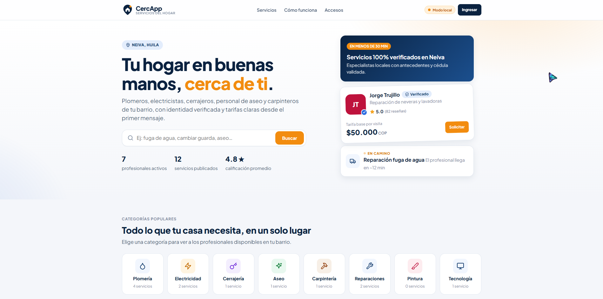
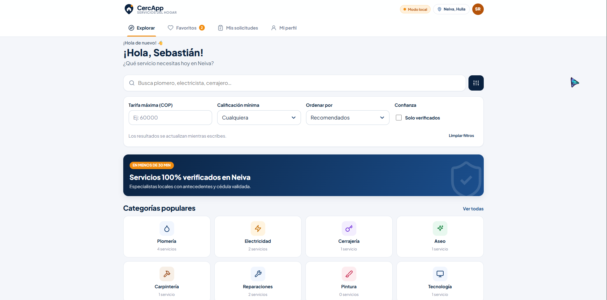
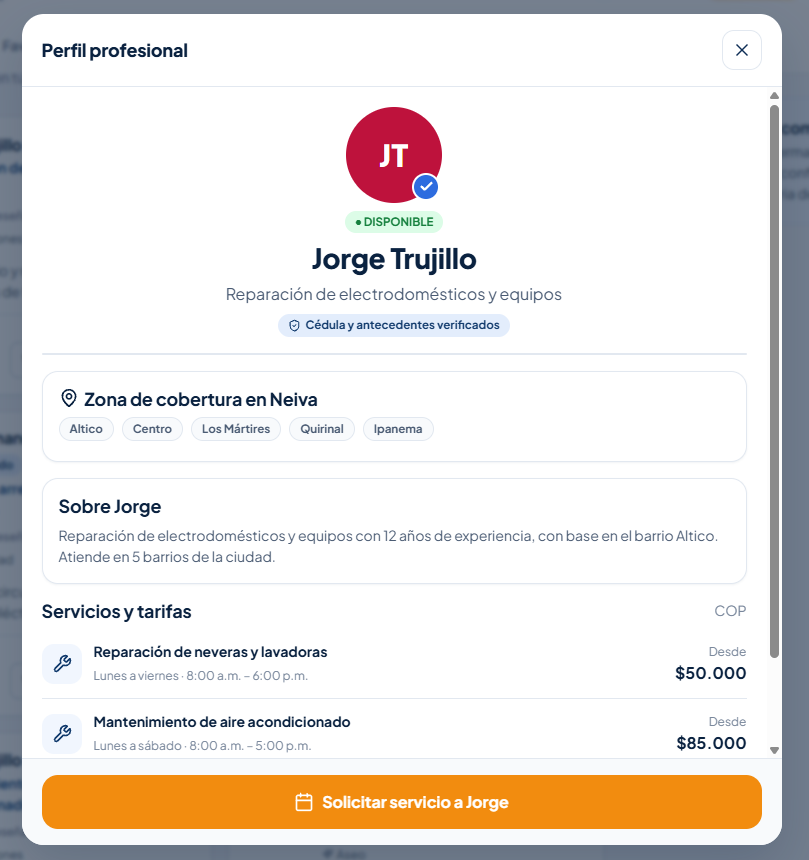
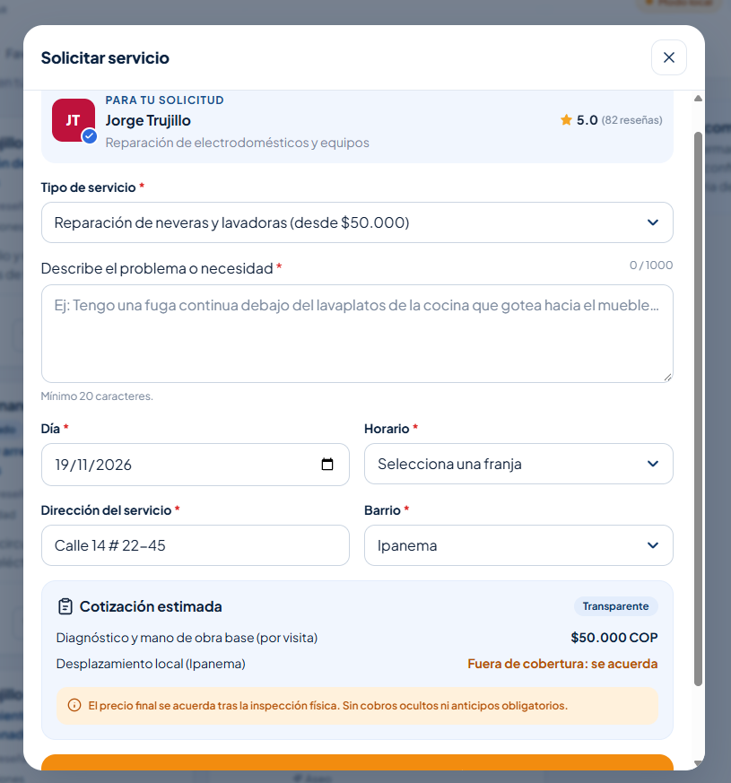
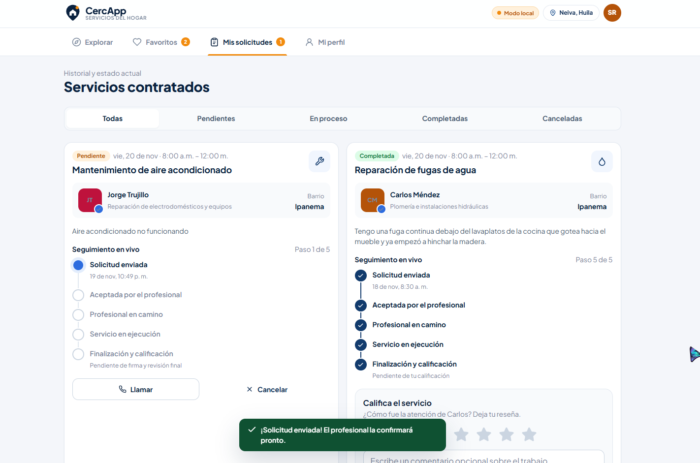
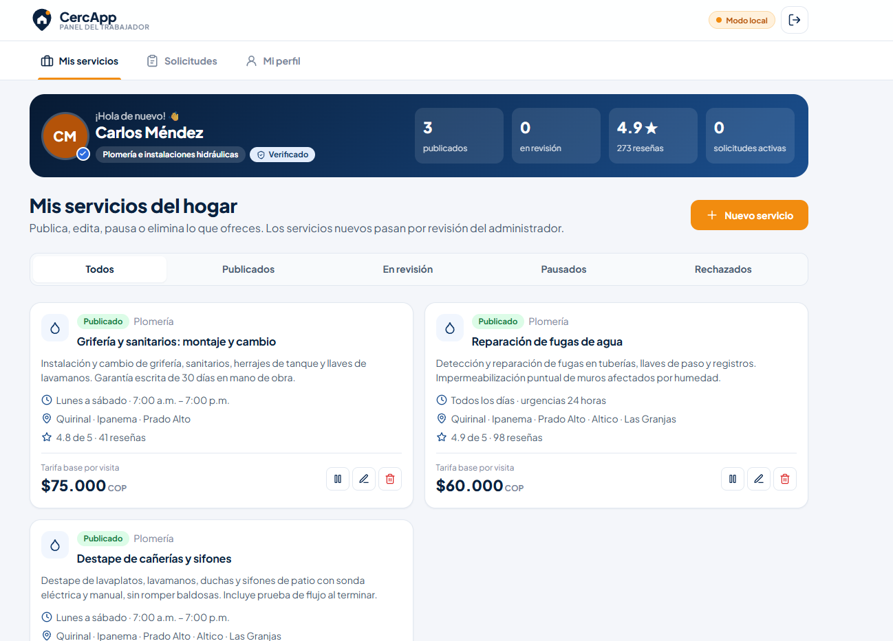
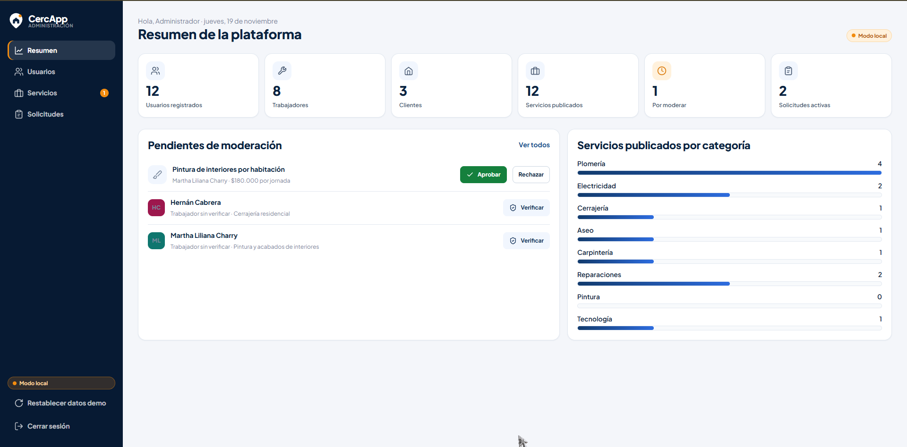
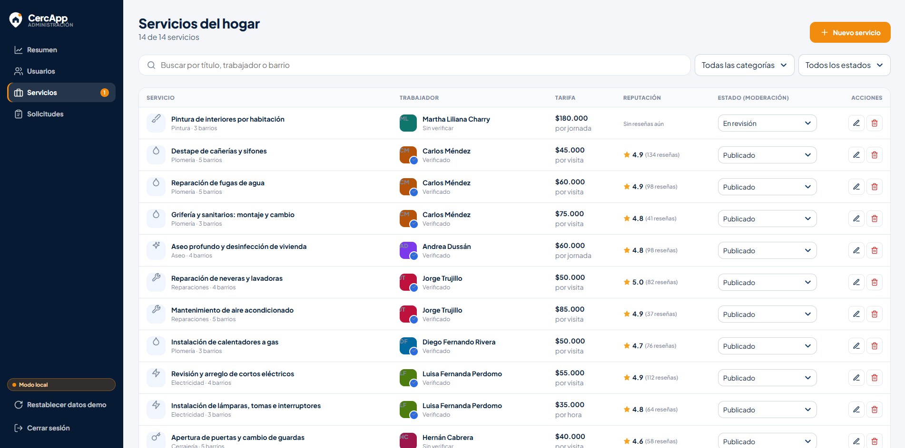
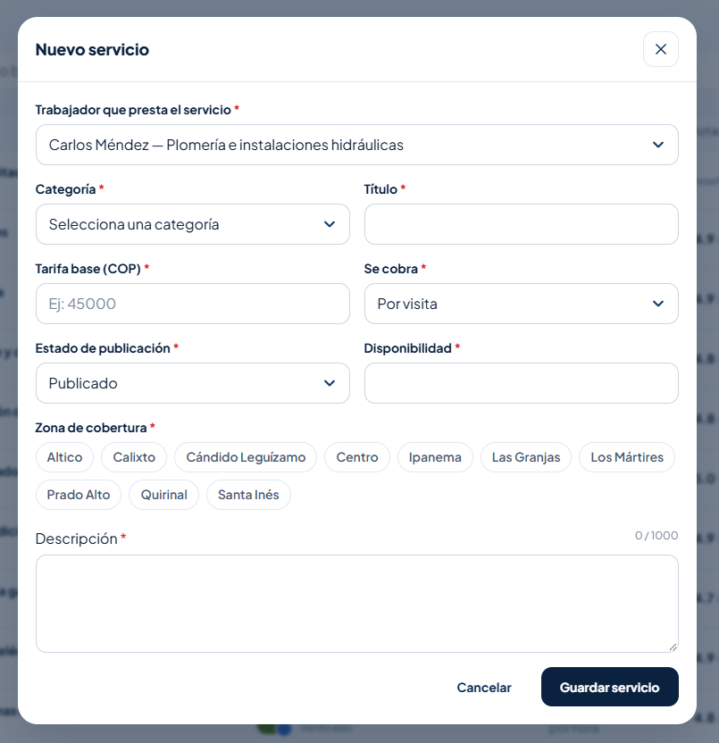

<!-- Ruta: README.md -->
# CercApp — Servicios del hogar en Neiva

## Descripción breve

**CercApp** es una aplicación web que conecta a hogares de Neiva (Huila) con trabajadores de **servicios del hogar**: plomería, electricidad, cerrajería, aseo, carpintería, reparaciones, pintura y tecnología del hogar.

La plataforma cuenta con tres roles, cada uno con su propio panel:

- **Cliente:** busca y filtra servicios en tiempo real, guarda favoritos, solicita servicios, sigue su avance y los califica.
- **Trabajador:** crea, edita, pausa y elimina sus servicios (categoría, tarifa, disponibilidad, zona de cobertura y descripción) y gestiona las solicitudes que recibe.
- **Administrador:** realiza el CRUD global de usuarios y servicios, modera las publicaciones (aprobar o rechazar) y verifica o suspende trabajadores.

La arquitectura contempla una API REST en Java Spring Boot con base de datos MySQL y un respaldo automático en `localStorage` cuando el backend no está activo (modo local utilizado para la demostración).

---

## Tecnologías utilizadas

| Capa | Tecnologías |
|---|---|
| Frontend | HTML5, CSS3 (variables CSS, diseño *mobile-first* responsive), JavaScript Vanilla (ES2020, `fetch`, `localStorage`, `<dialog>`) |
| Persistencia local | `localStorage` en navegador (con datos semilla y restablecimiento desde administración) |
| Backend (arquitectura incluida) | Java 17, Spring Boot 3.3 (Spring Web, Spring Data JPA, Bean Validation), Hibernate, Maven |
| Base de datos (arquitectura incluida) | MySQL 8 (administrada con MySQL Workbench) |
| Tipografía | Plus Jakarta Sans (Google Fonts) |

> No se usan Node.js ni React: el frontend son archivos estáticos que no necesitan compilación.

### Estructura de carpetas

```text
CercApp_FullStack/
├── backend/
│   ├── pom.xml
│   └── src/main/
│       ├── java/com/cercapp/
│       │   ├── CercAppApplication.java
│       │   ├── model/        Usuario.java, ServicioHogar.java, Solicitud.java
│       │   ├── repository/   UsuarioRepository.java, ServicioHogarRepository.java, SolicitudRepository.java
│       │   └── controller/   UsuarioController.java, ServicioHogarController.java,
│       │                     SolicitudController.java, ApiExceptionHandler.java
│       └── resources/application.properties
├── database/schema.sql
├── docs/capturas/          Capturas de pantalla
├── index.html              Landing pública y acceso por rol
├── styles.css              Estilos globales
├── common.js               Capa de datos con fallback, validaciones, sesión y utilidades
├── admin_dashboard.html / admin_dashboard.js
├── trabajador_panel.html / trabajador_panel.js
├── cliente_portal.html  / cliente_portal.js
└── README.md
```

---

## Instrucciones para ejecutar el proyecto (Modo local — sin base de datos)

La aplicación está configurada para funcionar de inmediato en el navegador mediante `localStorage`, sin necesidad de instalar MySQL ni Java:

1. Clona o descarga el repositorio y abre la carpeta del proyecto en **VS Code** (o tu editor preferido).
2. Abre `index.html` usando **Live Server** (recomendado) o inicia un servidor estático simple, por ejemplo:
   ```bash
   python -m http.server 5500

### 3. Cuentas de prueba

| Rol | Correo | Contraseña |
|---|---|---|
| Administrador | `admin@cercapp.co` | `admin123` |
| Trabajador | `carlos.mendez@cercapp.co` | `trabajador123` |
| Cliente | `sebastian.rojas@correo.com` | `cliente123` |

El modal de inicio de sesión tiene un botón **"Usar cuenta demo"** que rellena estos datos.

### Endpoints principales de la API (`http://localhost:8080/api`)

| Recurso | Endpoints |
|---|---|
| Usuarios | `GET/POST /usuarios`, `GET/PUT/DELETE /usuarios/{id}`, `POST /usuarios/login` |
| Favoritos | `GET /usuarios/{id}/favoritos`, `POST/DELETE /usuarios/{id}/favoritos/{servicioId}` |
| Servicios | `GET /servicios?categoria=&estado=&trabajadorId=&q=`, `POST /servicios`, `GET/PUT/DELETE /servicios/{id}` |
| Solicitudes | `GET /solicitudes?clienteId=&trabajadorId=`, `POST /solicitudes`, `PUT/DELETE /solicitudes/{id}` |

---

## Capturas de pantalla

Tomadas con el backend apagado (modo local), con los datos de ejemplo.

### Landing page


### Cliente: catálogo con búsqueda y filtros


### Cliente: perfil profesional del trabajador


### Cliente: solicitar un servicio


### Cliente: servicios contratados (seguimiento y calificación)


### Trabajador: panel de servicios


### Administrador: resumen y moderación


### Administrador: gestión de servicios


### Validaciones de formulario (teléfono de 10 dígitos y campos obligatorios)


---

## Prompts utilizados

El proyecto se construyó con un asistente de IA (Claude). Estos son los prompts que usé, en orden, con lo que pedí en cada uno y para qué.

### Prompt 1 — Construcción completa del proyecto (texto + 5 maquetas)

Un solo mensaje con un archivo de texto con las instrucciones y cinco imágenes de maquetas móviles. Tenía estas partes:

| Parte del prompt | Qué pedí | Para qué |
|---|---|---|
| **Rol del asistente** | Que actuara como *"Arquitecto de Software Full-Stack Senior experto en Java Spring Boot, JPA/Hibernate, MySQL y frontend modular (HTML5, CSS3, JavaScript Vanilla)"*. | Obtener código con criterio profesional de arquitectura y no solo fragmentos sueltos. |
| **Contexto del proyecto** | Construir CercApp, dedicada **exclusivamente a servicios del hogar**, con la prohibición explícita de incluir turismo, viajes o tours. Definí los tres roles (Administrador, Trabajador, Cliente) y lo que hace cada uno. | Delimitar el dominio del negocio y evitar que se mezclaran temáticas ajenas. |
| **Separación estricta de archivos** | Un archivo por responsabilidad: `index.html`, `styles.css` y un par HTML + JS por rol (`admin_dashboard`, `trabajador_panel`, `cliente_portal`), más el `README.md`. | Tener un frontend modular, ordenado por rol y fácil de mantener. |
| **Backend en Java** | `pom.xml` con web, data-jpa y mysql-connector-j; `application.properties` para MySQL; entidades `Usuario` y `ServicioHogar`; repositorios; controladores REST con CRUD completo (`GET`, `POST`, `PUT`, `DELETE`) y `@CrossOrigin`. | Tener una API REST real que conecte el frontend con la base de datos. |
| **Base de datos** | `database/schema.sql` con `CREATE DATABASE`, tablas relacionales, llaves foráneas, tabla de favoritos y datos semilla realistas de servicios del hogar. | Poder montar la base en MySQL Workbench con un solo script y datos listos para probar. |
| **Resiliencia (fallback)** | Que cada `fetch()` a `http://localhost:8080/api/...` cayera automáticamente a `localStorage` si el backend no responde. | Que la aplicación funcione de inmediato aunque el backend esté apagado, para demostraciones y pruebas. |
| **Validaciones** | Campos numéricos (tarifa, años de experiencia) que rechacen letras, teléfono de exactamente 10 dígitos y bloqueo de campos obligatorios vacíos. | Garantizar datos correctos desde el formulario. |
| **Comentarios en el código** | Comentarios claros sobre las funciones principales del CRUD y la lógica de fallback. | Que el código se entienda y se pueda explicar al sustentar el proyecto. |
| **Estructura y formato de entrega** | Un árbol de carpetas exacto; cada archivo con su ruta en la primera línea y sin código abreviado (nada de "resto del código igual"). | Recibir archivos completos y listos para copiar en su lugar. |
| **5 imágenes de maquetas móviles** | Pantallas de referencia: inicio del cliente, resultados de búsqueda, perfil profesional, solicitar servicio y servicios contratados (contexto de Neiva, Huila). | Que la interfaz siguiera el diseño visual definido: colores azul marino y naranja, tarjetas de profesionales verificados, línea de tiempo del pedido y calificación con estrellas. |

**Resultado:** todo el código del proyecto. El asistente también añadió `common.js` (código compartido de fallback, validaciones y sesión), la entidad `Solicitud` (para las pantallas de solicitar y seguimiento de las maquetas) y `ApiExceptionHandler` (errores de validación en formato JSON uniforme).

### Prompt 2 — Documentación del proyecto

> *"Dame el README.md que incluya lo siguiente: nombre del proyecto, descripción breve, tecnologías utilizadas, instrucciones para ejecutar el proyecto, capturas de pantalla y lista de los prompts que usaste, cada uno con su explicación (qué pediste y para qué)."*

| Qué pedí | Para qué |
|---|---|
| Rehacer el `README.md` con secciones concretas: nombre, descripción, tecnologías, ejecución, capturas y prompts. | Documentar el proyecto con el formato de entrega requerido y dejar constancia de cómo se usó la IA en el desarrollo. |

**Resultado:** este archivo y las capturas de la carpeta `docs/capturas/`.

---

## Notas

- Proyecto académico: las contraseñas se guardan sin cifrar. En producción habría que usar BCrypt y Spring Security con JWT.
- Los cambios hechos en **modo local** no se sincronizan con MySQL cuando el backend vuelve a estar disponible.
- Para reiniciar los datos del navegador: panel de administrador → **"Restablecer datos demo"**.
